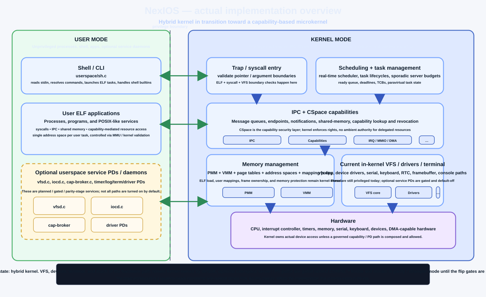

<!-- SEO Metadata: NexIOS is an independent custom operating system project. It is not affiliated with Cisco NX-OS, Cisco IOS, NixOS, or Nexos. Dedicated C++20 x86_64 AARCH64 RISCV64 Hard Real-Time Kernel. -->
<p align="center">
  
</p>

<h1 align="center">NexIOS RTOS</h1>
<p align="center">
  <em>A deterministic, real-time operating system built from scratch in freestanding C++20.</em>
</p>
<p align="center">
  <strong>🌐 Project website: <a href="https://nexios-2.jimdosite.com">https://nexios-2.jimdosite.com</a></strong>
</p>

<p align="center">
  
  
  
</p>

---

## Table of Contents

- [Overview NexIOS](#overview-nexios)
- [Diagram of actual implementation](#diagram-of-actual-implementation)
- [Who Needs This?](#who-needs-this)
- [Why not Zephyr (or FreeRTOS)?](#why-not-zephyr-or-freertos)
- [Demo](#demo)
- [Roadmap & History](#roadmap--history)
- [Recent Release Highlights](#recent-release-highlights)
- [Community, Support & Q&A](#community-support--qa)
- [Build & Quick Start](#build--quick-start)
  - [Using Docker (recommended)](#using-docker-recommended)
  - [Running in QEMU Emulator](#running-in-qemu-emulator)
  - [Upload files into ramdisk (XMODEM)](#upload-files-into-ramdisk-xmodem)
 
---

## Overview NexIOS

A freestanding C++20 multi-architecture real-time operating system with zero dynamic heap allocation (Slab-Allocator) in critical paths and deterministic O(1) scheduling.

Currently a hybrid kernel actively transitioning toward a capability-based microkernel.

* **Target:** x86_64, ARM64 & RISC-V (QEMU only, untested on bare metal), bring-up on Raspberry Pi4 planned
* **Language:** Freestanding C++20 (`-fno-exceptions`, `-fno-rtti`, zero `libc`/`libstdc++`)
* **Status:** v0.6.0 — Scheduler lifecycle & cross-arch parity (task-accounting birth/death symmetry, SMP shootdown accounting, riscv64/aarch64 bring-up fixes, release-version gates green on all three architectures)
* **License:** GPLv3

---

## Diagram of actual implementation



---

## Who Needs This?

NexIOS combines MMU process isolation and capability-based security (CSpace) with a straightforward workflow:  **your application is just an ELF file on the system — NexIOS keeps it running on time, every time.**

Write your control logic in C, C++, or Rust and execute it directly via the POSIX-compliant NexIOS shell (Note: All userapps are right now simple demonstrations. We are looking for real testers to flag the possible quirks). Applications can be dynamically loaded from storage or secondary media without needing a system reboot. If an application fails, simply reload and restart it. Handy for a rapid application development (RAD) system without re-flashing like: 

* **Robotics & Motion Control:** High-frequency servo and actuator control loops requiring strict sub-millisecond execution windows.
* **Industrial & Home Automation:** Multi-tasking controllers (e.g., climate regulation, energy management, sensor pipelines) where individual services can be updated on the fly without stopping core safety routines.
* **Rapid Edge Prototyping:** Dropping and testing updated user binaries on real-time target hardware without re-flashing the underlying kernel.

If you have been looking for exactly this kind of system and want to help test or build it: 
**this project is GPLv3 open source, and contributors are welcome.**
Please read through open roadmap issues before submitting major architectural changes.

---

## Why not Zephyr (or FreeRTOS)?

This project is still highly experimental and not a production system. It's young: QEMU only so far, no certification (and possibly never one), no published latency numbers yet, no broad hardware support, no ecosystem. Those are the next things to fix, and help is welcome.

But most embedded RTOSes (like FreeRTOS or Zephyr) are typically built as a single image where a fault in one thread can take down the whole system. NexIOS goes a different way: apps are plain ELF binaries, each in its own MMU address space, loaded and reloaded at runtime without re-flashing. You don't need to be a kernel expert (or a mathematician) to use it: write your app, drop the ELF on the system, run it from the shell. Isolation and capabilities are handled by the kernel.

Additionally, the NexIOS shell includes the tools needed to measure your application, or you can build your own.

---

## Demo

<p align="center">
<a href="https://youtu.be/-jyvFReC9K8">
  
</a>
</p>
<p align="center">
  <em>NexIOS demo — real-time kernel for safety (click to watch on YouTube)</em>
</p>

---

## Roadmap & History

- **Current work:** [GitHub Milestones](https://github.com/staycool1374-Ger/nexios/milestones) — open items tracked as Issues.
- **Full backlog:** ~80 aspirational roadmap items as [GitHub Issues](https://github.com/staycool1374-Ger/nexios/issues) (labeled `feature`, grouped by phase).

Done roadmap archived in `prompts/README_done.md`.

---

## Recent Release Highlights

### v0.6.0: Scheduler Lifecycle & Cross-Arch Parity
* **Task accounting birth/death symmetry + SMP shootdown observability**
* **riscv64/aarch64 bring-up: canonical private window, fault-recovery keep-alive, yield-stub entry parity**
* **Release-version gates green (debug + release) on x86_64/aarch64/riscv64; interactive shell + dmesg catalog fixes**
* **Foundations carried:** planner → implement → SIL 3 audit pipeline, test-history discipline, audit-trail artifacts

### v0.5.7: SMP Multicore Enablement & Cross-CPU Shootdown
* **SMP Bring-Up**
* **Cross-CPU TLB Shootdown**
* **Scheduler + IPC Hardening**
* **Foundations carried:** SMP-safe globals, EL0 guard-arm, toolchain parity

---

## Community, Support & Q&A

Have questions about the architecture, CSpace capabilities, or real-time scheduling guarantees?

* **Q&A Thread:** Check out or participate in our central [Q&A Discussion #189](https://github.com/staycool1374-Ger/nexios/discussions/189).
* **Issue Tracker:** Report bugs or discuss upcoming features on [GitHub Issues](https://github.com/staycool1374-Ger/nexios/issues).

---
  
## Build & Quick Start

#### Using Docker (recommended)

```bash
docker pull ghcr.io/staycool1374-ger/nexios-env:v0.5.7
docker run --rm -it -e NEXIOS_TAG=main ghcr.io/staycool1374-ger/nexios-env:v0.5.7
# inside the container:
tools/meson/build.sh
python3 tools/meson/qemu_test.py --arch x86_64 --build debug --class debug_syscall
```

> **Apple Silicon / arm64 hosts:** `docker pull` fetches the arm64 image
> by default, which emulates x86_64 via TCG (slower, same results). If
> you hit `BdsDxe ... Not Found` followed by `Start PXE over IPv4`, your
> image predates the multiarch GRUB fix — pull again, or force the amd64
> image explicitly (runs emulated, needs Rosetta/QEMU user-static):
> `docker pull --platform linux/amd64 ...` /
> `docker run --platform linux/amd64 ...`.

Run a gate directly without an interactive shell:

```bash
docker run --rm ghcr.io/staycool1374-ger/nexios-env:v0.5.7 \
    python3 tools/meson/qemu_test.py --arch x86_64 --build debug --class debug_syscall
```

Pin a different snapshot explicitly (default is the image's own tag):

```bash
docker run --rm -it -e NEXIOS_TAG=main ghcr.io/staycool1374-ger/nexios-env:v0.5.7
```
#### Running in QEMU Emulator

* **Interactive Debug Mode (Default x86_64):** Launches the kernel in QEMU with serial debug output active.
  ```bash
  tools/meson/build.sh build/meson-x86_64
  qemu-system-x86_64 -cdrom build/meson-x86_64/src/nexios-rtos.iso -m 256M \
      -serial mon:stdio -display none
  ```
* **Cross-Architecture Targeting:** Build the arch builddir, then boot its kernel ELF directly:
  ```bash
  tools/meson/build.sh build/meson-aarch64    # Boots AArch64 target in QEMU
  qemu-system-aarch64 -M virt -cpu cortex-a72 -kernel build/meson-aarch64/src/kernel-debug.elf \
      -serial mon:stdio -display none
  tools/meson/build.sh build/meson-riscv64    # Boots RISC-V 64 target in QEMU
  qemu-system-riscv64 -M virt -kernel build/meson-riscv64/src/kernel-riscv64.bin \
      -serial mon:stdio -display none
  ```

#### Upload files into ramdisk (XMODEM)

One command streams a host file into the running ramdiskd, with progress
on both ends (host `\r` line + receiver `[rx n=..]` lines). Needs a
running target on TCP serial — the proven path is q35+OVMF without the
IDE drive (see `docs/specs/xmodem.md`):

```bash
# 1. Boot with TCP serial, then start the receiver once:
qemu-system-x86_64 -cdrom build/meson-x86_64/src/nexios-rtos.iso -m 256M \
  -serial tcp:127.0.0.1:4465,server,nowait -machine q35 -cpu max \
  -drive if=pflash,format=raw,readonly=on,file=<edk2-x86_64-code.fd> \
  -display none
# (in the shell over that serial:) source /tests/xmodem276.txt

# 2. Upload (framing auto-selects raw vs base64; --start-block required):
tools/upload-ramdisk.py myfile.bin --start-block 1000
# upload done bytes=20480 blocks=40 framing=raw naks=0 spill=55 time=127.0s
```

Exit codes: `0` ok, `1` dialogue/handshake, `2` usage/count mismatch,
`3` receiver abort (nothing written), `4` timeout. `--selftest` checks
the host logic without a target. Details: `docs/specs/xmodem.md`.
