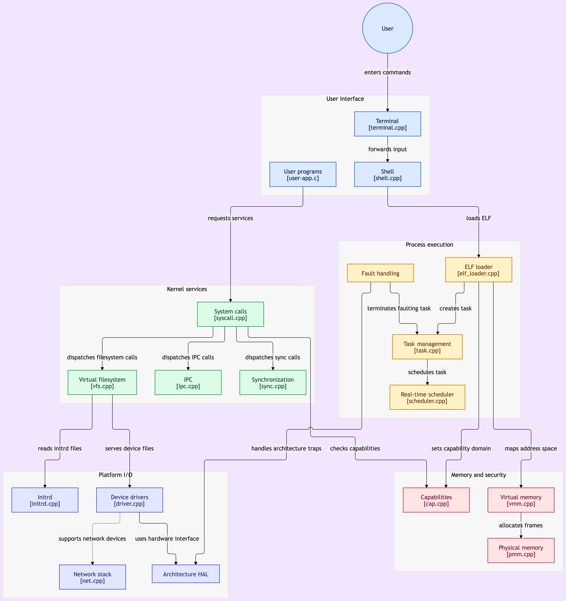
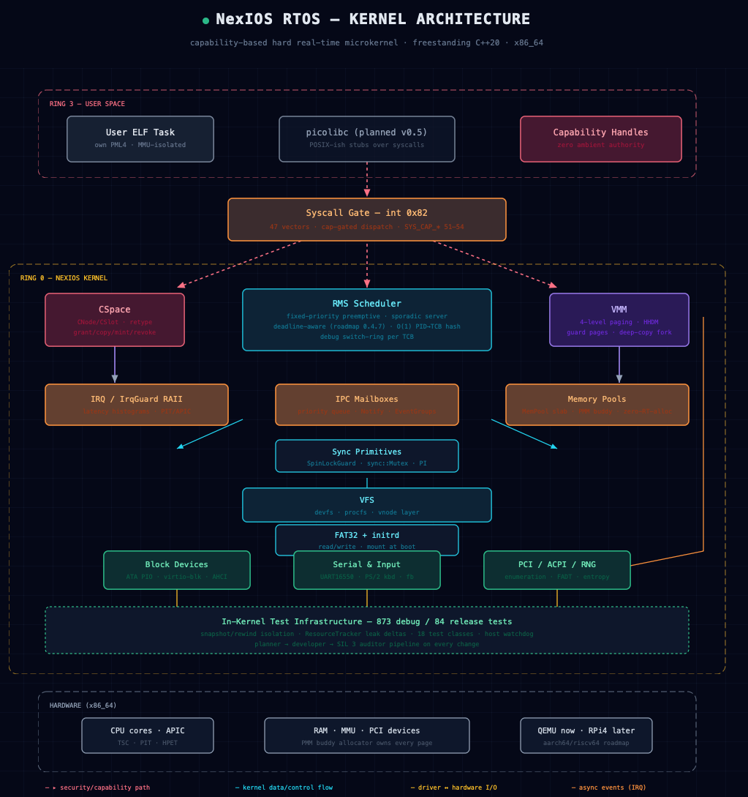

<!-- SEO Metadata: NexIOS is an independent custom operating system project. It is not affiliated with Cisco NX-OS, Cisco IOS, NixOS, or Nexos. Dedicated C++20 x86_64 AARCH64 RISCV64 Hard Real-Time Kernel. -->
<p align="center">
  
</p>

<h1 align="center">NexIOS RTOS</h1>
<p align="center">
  <em>A deterministic, safety-critical real-time operating system built from scratch in freestanding C++20.</em>
</p>
<p align="center">
  <strong>🌐 Project website: <a href="https://nexios-2.jimdosite.com">https://nexios-2.jimdosite.com</a></strong>
</p>

<p align="center">
  <a href="https://github.com/staycool1374-Ger/nexios/actions/workflows/ci.yml"></a>
  
  
  
  
  
  
  
</p>

---

## Overview NexIOS

A freestanding C++20 multi-architecture real-time operating system with zero dynamic heap allocation (Slab-Allocator) in critical paths and deterministic O(1) scheduling.

Currently a hybrid kernel actively transitioning toward a capability-based microkernel.

* **Target:** x86_64, ARM64 & RISC-V (QEMU only, untested on bare metal)
* **Language:** Freestanding C++20 (`-fno-exceptions`, `-fno-rtti`, zero `libc`/`libstdc++`)
* **Status:** v0.5.7 — SMP multicore enablement across all three architectures (AP bring-up, cross-CPU TLB shootdown, scheduler/IPC hardening), rv64 trap fix
* **License:** GPLv3

NexIOS RTOS is an independent, ground-up implementation of a real-time operating system.

---

## Diagram of actual implementation



---

## Who Needs This?

NexIOS combines MMU process isolation and capability-based security (CSpace) with a straightforward workflow:  **your application is just an ELF file on the system — NexIOS keeps it running on time, every time.**

Write your control logic in C, C++, or Rust and execute it directly via the POSIX-compliant NexIOS shell. Applications can be dynamically loaded from storage or secondary media without needing a system reboot. If an application fails, simply reload and restart it. Handy for a rapid application development (RAD) system without re-flashing like: 

* **Robotics & Motion Control:** High-frequency servo and actuator control loops requiring strict sub-millisecond execution windows.
* **Industrial & Home Automation:** Multi-tasking controllers (e.g., climate regulation, energy management, sensor pipelines) where individual services can be updated on the fly without stopping core safety routines.
* **Rapid Edge Prototyping:** Dropping and testing updated user binaries on real-time target hardware without re-flashing the underlying kernel.

If you have been looking for exactly this kind of system and want to help test or build it: 
**this project is GPLv3 open source, and contributors are welcome.**
Please read through open roadmap issues before submitting major architectural changes.

---

## Demo

<p align="center">
  <a href="https://youtu.be/-jyvFReC9K8?si=b71XUpnEghm0CTqk">
    
  </a>
</p>
<p align="center">
  <em>NexIOS demo — real-time kernel for safety (click to watch on YouTube)</em>
</p>

<p align="center">
  
</p>

---

## Roadmap & History

- **Current work:** [GitHub Milestones](https://github.com/staycool1374-Ger/nexios/milestones) — open items tracked as Issues.
- **Full backlog:** ~80 aspirational roadmap items as [GitHub Issues](https://github.com/staycool1374-Ger/nexios/issues) (labeled `feature`, grouped by phase).

Done roadmap archived in `prompts/README_done.md`.

---

## Recent Release Highlights

### v0.5.7: SMP Multicore Enablement & Cross-CPU Shootdown
* **SMP Bring-Up (#351, slices 0–4):** DTB CPU discovery (fail-closed), aarch64 PSCI bring-up + SGI IPI, riscv64 HSM bring-up + SBI IPI + per-CPU identity, arch-neutral IPI send interface, per-hart scheduler slots + AP tick/upcpu/IPI delivery on both AP arches.
* **Cross-CPU TLB Shootdown (#389):** strong per-arch hook overrides (x86 Batch via S4 iface with PCID-precise + all-bit apply, aa64 SGI-10 purge-on-receipt, rv64 RFENCE broadcast + S-soft fallback) adopted at all VMM unmap/teardown/map-split sites through the `tlb_shootdown` choke point; boot-phase fan-out gated on scheduler start.
* **Scheduler + IPC Hardening (#402 S4/S6):** PI re-bucket of queued owners on boost/restore (mutex/semaphore, mirroring queue/IPC) and `pool_lock_` guarding of the BufferPool free-list/entries (SMP race fix); full S0–S6 SMP spec audited with carry-not-redo discipline.
* **RV64 Trap Fix (#440):** foreign-tp slot-0 fallback in the trap epilogue unblocks deferred-switch apply from user context (exec zeroes user tp), fixing the rv64 boot stall.
* **Foundations carried in:** SMP-safe globals (#386), EL0 guard-arm E2E (#435), toolchain parity (#437 aarch64 atomics, #439 `-fno-pie`), QE shootdown E2E probes.
* **Test counts:** TBD — pending QE release-gate sweep (coordinator relays counts).

### v0.5.6: Meson Cutover, Userspace SDK & kstack Guard Parity
* **Meson Build System (#170):** full Meson cutover for build, test registry, and QEMU harness flows (build.sh, qemu_test.py, gen_test_registry).
* **Userspace SDK (#171):** Ring-3 driver surface with reference driver (userspace/ref-driver.c), driver guide (docs/writing-a-nexios-driver.md), and staged SDK install under /opt/nexios-sdk.
* **v0.5.6 Bug Run:** checked_ptr untag fault-repro fix with E2E vehicle, QEMU headless-display parity (F2).
* **kstack Parity + Guard Page:** aa64 kslot window wiring (P1), ELF birth-stack routing (P2), shared guard-fault predicate + aa64 EL1 abort arm + snapshot round-trip (P3), task integration + regression.
* **QEMU/Tooling (F2):** headless parity for x86_64 QEMU runs (-display none), tooling hardening.

### v0.5.5: Architecture Parity & Hardening
* **Interrupt & Timer Subsystems:** Full parity across platforms, including GICv2 initialization (ARM) and PLIC S-context handling (RISC-V).
* **Task Context & FPU:** Eager FPU switching, architecture-independent fork/clone paths.
* **Security & Isolation:** Fail-closed contracts for DMA, hardware discovery, and synthetic parent-clone restrictions.
* **Console Infrastructure:** Bounded URC (Unsolicited Result Code) console discipline and zero-copy shell slices.
* **Harness & Docs:** shell-smoke E2E chain on release, dump-counts reconciliation.

---

## Community, Support & Q&A

Have questions about the architecture, CSpace capabilities, or real-time scheduling guarantees?

* **Q&A Thread:** Check out or participate in our central [Q&A Discussion #189](https://github.com/staycool1374-Ger/nexios/discussions/189).
* **Issue Tracker:** Report bugs or discuss upcoming features on [GitHub Issues](https://github.com/staycool1374-Ger/nexios/issues).

---
  
## Build & Quick Start

#### Using Docker (recommended)

```bash
docker pull ghcr.io/staycool1374-ger/nexios-env:v0.5.5
docker run --rm -it ghcr.io/staycool1374-ger/nexios-env:v0.5.5
# inside the container:
tools/meson/build.sh
python3 tools/meson/qemu_test.py --arch x86_64 --build debug --class debug_syscall
```

> **Apple Silicon / arm64 hosts:** `docker pull` fetches the arm64 image
> by default, which emulates x86_64 via TCG (slower, same results). If
> you hit `BdsDxe ... Not Found` followed by `Start PXE over IPv4`, your
> image predates the multiarch GRUB fix — pull again, or force the amd64
> image explicitly (runs emulated, needs Rosetta/QEMU user-static):
> `docker pull --platform linux/amd64 ...` /
> `docker run --platform linux/amd64 ...`.

Run a gate directly without an interactive shell:

```bash
docker run --rm ghcr.io/staycool1374-ger/nexios-env:v0.5.5 \
    python3 tools/meson/qemu_test.py --arch x86_64 --build debug --class debug_syscall
```

Pin a different snapshot explicitly (default is the image's own tag):

```bash
docker run --rm -it -e NEXIOS_TAG=main ghcr.io/staycool1374-ger/nexios-env:v0.5.3
```
#### Running in QEMU Emulator

* **Interactive Debug Mode (Default x86_64):** Launches the kernel in QEMU with serial debug output active.
  ```bash
  tools/meson/build.sh build/meson-x86_64
  qemu-system-x86_64 -cdrom build/meson-x86_64/src/nexios-rtos.iso -m 256M \
      -serial mon:stdio -display none
  ```
* **Cross-Architecture Targeting:** Build the arch builddir, then boot its kernel ELF directly (`x86`, `arm`, or `riscv` shorthands below are illustrative — use full arch names):
  ```bash
  tools/meson/build.sh build/meson-aarch64    # Boots AArch64 target in QEMU
  qemu-system-aarch64 -M virt -cpu cortex-a72 -kernel build/meson-aarch64/src/kernel-debug.elf \
      -serial mon:stdio -display none
  tools/meson/build.sh build/meson-riscv64    # Boots RISC-V 64 target in QEMU
  qemu-system-riscv64 -M virt -kernel build/meson-riscv64/src/kernel-riscv64.bin \
      -serial mon:stdio -display none
  ```

#### Upload files into ramdisk (XMODEM)

One command streams a host file into the running ramdiskd, with progress
on both ends (host `\r` line + receiver `[rx n=..]` lines). Needs a
running target on TCP serial — the proven path is q35+OVMF without the
IDE drive (see `docs/specs/xmodem.md`):

```bash
# 1. Boot with TCP serial, then start the receiver once:
qemu-system-x86_64 -cdrom build/meson-x86_64/src/nexios-rtos.iso -m 256M \
  -serial tcp:127.0.0.1:4465,server,nowait -machine q35 -cpu max \
  -drive if=pflash,format=raw,readonly=on,file=<edk2-x86_64-code.fd> \
  -display none
# (in the shell over that serial:) source /tests/xmodem276.txt

# 2. Upload (framing auto-selects raw vs base64; --start-block required):
tools/upload-ramdisk.py myfile.bin --start-block 1000
# upload done bytes=20480 blocks=40 framing=raw naks=0 spill=55 time=127.0s
```

Exit codes: `0` ok, `1` dialogue/handshake, `2` usage/count mismatch,
`3` receiver abort (nothing written), `4` timeout. `--selftest` checks
the host logic without a target. Details: `docs/specs/xmodem.md`
(operator section) and issue #313.
